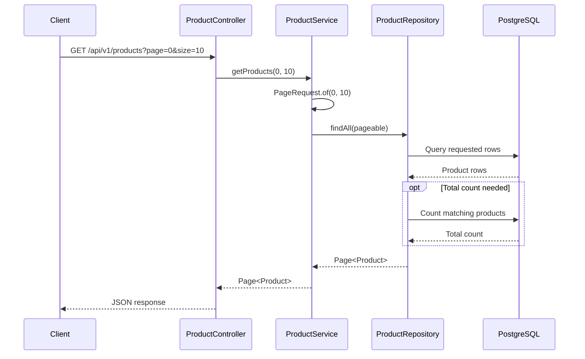

# Pagination in Spring Boot — Project Notes

These notes explain why pagination is useful and how this project's product API implements it. Examples marked **suggested improvement** are learning examples, not changes to the application.

## 1. What is pagination?

Pagination divides a large result set into smaller portions called **pages**. A client requests one page at a time instead of downloading every record.

For example, with 105 products and a page size of 10:

- There are 11 pages.
- Pages 0–9 contain 10 products each.
- Page 10 contains the remaining 5 products.

Spring Data uses **zero-based page numbers**: page `0` is the first page. `PageRequest` requires a nonnegative page number and a positive size. See the [official PageRequest API](https://docs.spring.io/spring-data/data-jpa/reference/data-commons/api/java/org/springframework/data/domain/PageRequest.html).

```text
105 matching products, in a defined order
  |
  +-- Page 0  -> positions   1–10
  +-- Page 1  -> positions  11–20
  +-- ...
  +-- Page 10 -> positions 101–105
```

Positions are not product IDs; IDs may have gaps.

## 2. Why do we need pagination?

Imagine a product catalog containing 100,000 products. Returning all of them for every request means loading many Java objects, serializing a large JSON response, transferring it over the network, and asking the client to process it.

Usually, the user only needs the first few results. Database pagination limits the rows returned for that request.

| Advantage | Practical benefit |
| --- | --- |
| Smaller responses | Less data is transferred per request. |
| Lower application memory use | Fewer product entities and response objects are held at once. |
| Less serialization work | The server converts fewer products into JSON. |
| More responsive interfaces | Clients render manageable groups of products. |
| Better capacity under load | Bounded requests reduce per-request resource consumption. |
| Easier navigation | Users can move through results using page controls. |

Pagination is not a guarantee of fast database queries: sorting, counting, filters, indexes, and large offsets still affect performance. Fetching every page also requires multiple requests.

**Important:** fetching all rows with `findAll()` and then taking a Java `subList()` does not provide the database and application-memory benefits of fetching a page directly.

## 3. Project structure and prerequisites

The project's `pom.xml` declares Spring Boot `4.1.1` and Java `17`. It includes Spring Data JPA, Spring Web MVC, PostgreSQL, Bean Validation, and Lombok.

| File | Responsibility |
| --- | --- |
| [Product.java](src/main/java/com/durgasoft/spring_boot_pagination/entity/Product.java) | Maps a product to the `products` table. |
| [ProductRepository.java](src/main/java/com/durgasoft/spring_boot_pagination/repository/ProductRepository.java) | Provides database access through `JpaRepository`. |
| [ProductService.java](src/main/java/com/durgasoft/spring_boot_pagination/service/ProductService.java) | Builds the pagination request and calls the repository. |
| [ProductController.java](src/main/java/com/durgasoft/spring_boot_pagination/controller/ProductController.java) | Accepts HTTP requests for products. |
| [application.properties](src/main/resources/application.properties) | Configures PostgreSQL and Hibernate. |

The configured database is PostgreSQL at `localhost:5432/product_db`. Before running the application, ensure the database exists, supply valid database credentials in your local environment, and populate `products` with sample records. Hibernate's `ddl-auto=update` can update tables; it does not create the PostgreSQL database or insert sample products. SQL logging is enabled in the current configuration.

## 4. Request flow



Text equivalent: **Client → Controller → Service → Repository → Database → Page response**. Mermaid diagrams render in compatible Markdown viewers, including GitHub.

## 5. How pagination is implemented here

### Step 1: Map the entity

`Product` uses `@Entity` and `@Table(name="products")`. It contains `id`, `name`, `category`, `price`, and `isAvailable`. The ID is a generated `Long`; `isAvailable` maps to the `is_available` database column.

Pagination does not require a special entity annotation.

### Step 2: Extend JpaRepository

Existing repository declaration:

```java
public interface ProductRepository extends JpaRepository<Product, Long> {
}
```

`Product` is the entity type, and `Long` is its ID type. Spring Data supplies the implementation, including `findAll(Pageable pageable)`, so this basic use case needs no custom SQL.

### Step 3: Create a Pageable in the service

Existing service method:

```java
public Page<Product> getProducts(int page, int size) {
    Pageable pageable = PageRequest.of(page, size);
    return productRepository.findAll(pageable);
}
```

Relevant imports:

```java
import org.springframework.data.domain.Page;
import org.springframework.data.domain.PageRequest;
import org.springframework.data.domain.Pageable;
```

`Pageable` describes the requested page, size, and optional sorting. `PageRequest` implements it. `Page<Product>` is the result container holding products and pagination metadata.

### Step 4: Expose the controller endpoint

The controller has `@RequestMapping("/api/v1/products")` and this method:

```java
@GetMapping
public Page<Product> getProduct(@RequestParam int page,
                                @RequestParam int size) {
    return productService.getProducts(page, size);
}
```

Both query parameters are currently **required**. There are no defaults, explicit input bounds, or sort parameters in this controller.

### Step 5: Request pages

With the application running on the default port 8080:

```http
GET http://localhost:8080/api/v1/products?page=0&size=10
GET http://localhost:8080/api/v1/products?page=1&size=10
GET http://localhost:8080/api/v1/products?page=2&size=5
```

In PowerShell:

```powershell
Invoke-RestMethod -Uri 'http://localhost:8080/api/v1/products?page=0&size=10'
```

These requests demonstrate the existing endpoint. Changing `size` changes page boundaries, so keep it consistent when navigating a result set.

## 6. What happens in the database?

Offset pagination uses these calculations:

```text
offset = page × size
totalPages = ceiling(totalElements / size)

page=2, size=5 -> offset=10 -> skip 10 rows, return up to 5 rows
```

Conceptual PostgreSQL query for the existing unsorted request:

```sql
SELECT * FROM products LIMIT 5 OFFSET 10;
```

Hibernate may generate equivalent SQL using `OFFSET` and `FETCH FIRST` syntax. The exact SQL depends on the dialect and version.

The current `PageRequest.of(page, size)` has **no explicit ordering**. Without `ORDER BY`, the database does not guarantee which records occupy each position. The position examples above assume a defined order; adding one is explained below.

## 7. Reading the result: Page, Slice, and List

| Type | Information provided | Typical use |
| --- | --- | --- |
| `Page<Product>` | Content, current page, total elements, total pages, navigation flags | Numbered navigation with totals |
| `Slice<Product>` | Content and whether another slice exists, without totals | Next/load-more navigation |
| `List<Product>` | Content only | Callers that do not need paging metadata |

A `Page` may require an additional count query. A `Slice` typically retrieves one extra row to determine whether more results exist and avoids the total-count query. Merely assigning a `Page` to a `Slice` variable does not change the repository query; use a repository method returning `Slice` when that behavior is needed. A list is only bounded when its query is limited. See [Spring Data query methods](https://docs.spring.io/spring-data/jpa/reference/repositories/query-methods-details.html).

Useful `Page` methods:

```java
Page<Product> result = productRepository.findAll(PageRequest.of(0, 10));
result.getContent();          // Products in this page
result.getNumber();           // Zero-based page number
result.getSize();             // Requested page size
result.getNumberOfElements(); // Actual number of products in this page
result.getTotalElements();    // Total matching products
result.getTotalPages();       // Number of pages
result.hasNext();             // Is there another page?
result.isFirst();             // Is this the first page?
result.isLast();              // Is this the last page?
```

For 105 products, requesting page `10` with size `10` yields 5 elements, 11 total pages, and no next page. A page beyond the available results normally has empty content.

The controller returns `Page<Product>` directly. Treat its serialized JSON structure as framework-dependent; these notes do not define an exact JSON contract. For a maintained public API, a dedicated response DTO can explicitly define `content`, `page`, `size`, `totalElements`, and `totalPages`.

## 8. Suggested improvements — not implemented

### Add predictable ordering

Replace the service's page request with:

```java
import org.springframework.data.domain.Sort;

Pageable pageable = PageRequest.of(page, size, Sort.by("id").ascending());
```

For price ordering, add a unique tie-breaker because several products may share a price:

```java
Sort sort = Sort.by("price").ascending()
        .and(Sort.by("id").ascending());
Pageable pageable = PageRequest.of(page, size, sort);
```

Sorting uses Java entity property names. If exposing sorting through query parameters, allow only supported properties. The current endpoint does not read a `sort` parameter.

### Add defaults and validate bounds

This alternative controller method supplies defaults and returns HTTP 400 for invalid numeric bounds:

```java
import org.springframework.http.HttpStatus;
import org.springframework.web.server.ResponseStatusException;

@GetMapping
public Page<Product> getProduct(
        @RequestParam(defaultValue = "0") int page,
        @RequestParam(defaultValue = "10") int size) {
    if (page < 0 || size < 1 || size > 100) {
        throw new ResponseStatusException(
                HttpStatus.BAD_REQUEST,
                "page must be >= 0 and size must be between 1 and 100");
    }
    return productService.getProducts(page, size);
}
```

The maximum of 100 is an example policy, not a Spring requirement. The existing implementation lets invalid bounds reach `PageRequest`, which throws an exception; it does not explicitly translate that exception into a friendly HTTP 400 response. Missing or non-integer parameters are handled by Spring MVC's request binding.

### Understand large offsets and concurrent changes

Deep pages can be expensive because the database still processes skipped rows. For sequential browsing of very large datasets, consider cursor/keyset pagination. A simplified ID-based query is:

```sql
SELECT * FROM products
WHERE id > :lastSeenId
ORDER BY id ASC
LIMIT :size;
```

This requires a different API and is not implemented here. It suits sequential navigation but does not directly support jumping to an arbitrary page number. Even with deterministic sorting, inserts and deletes between offset-based requests can shift records between pages; sorting alone does not provide a database snapshot across requests.

## 9. Manual learning checklist

With a known set of sample products, inspect these cases:

| Request/case | What to inspect |
| --- | --- |
| `page=0&size=10` | At most 10 products; current page is 0. |
| `page=1&size=10` | Second page; use explicit sorting for reliable comparisons. |
| Final page with an incomplete batch | Actual content count is smaller than requested size. |
| Page beyond the available results | Empty content. |
| Empty table | Empty content and zero total elements. |
| Missing or non-integer parameters | Request-binding error. |
| Negative page or zero size | Invalid input; current code lacks explicit error mapping. |
| Very large size | Current code has no application-level maximum. |

These are proposed manual checks, not recorded test results. The application and database were not started while preparing these documentation notes.

## 10. Quick revision

```text
Request:    GET /api/v1/products?page=0&size=10
Controller: reads page and size
Service:    PageRequest.of(page, size)
Repository: findAll(pageable)
Response:   Page<Product>
```

- Pagination bounds the records returned per request.
- Page numbers start at zero; size must be positive.
- `Pageable` describes the request; `Page` holds the result.
- `JpaRepository` already supplies basic pagination support.
- Add deterministic sorting and input limits for more reliable use.
- Totals and deep offsets have database costs.
